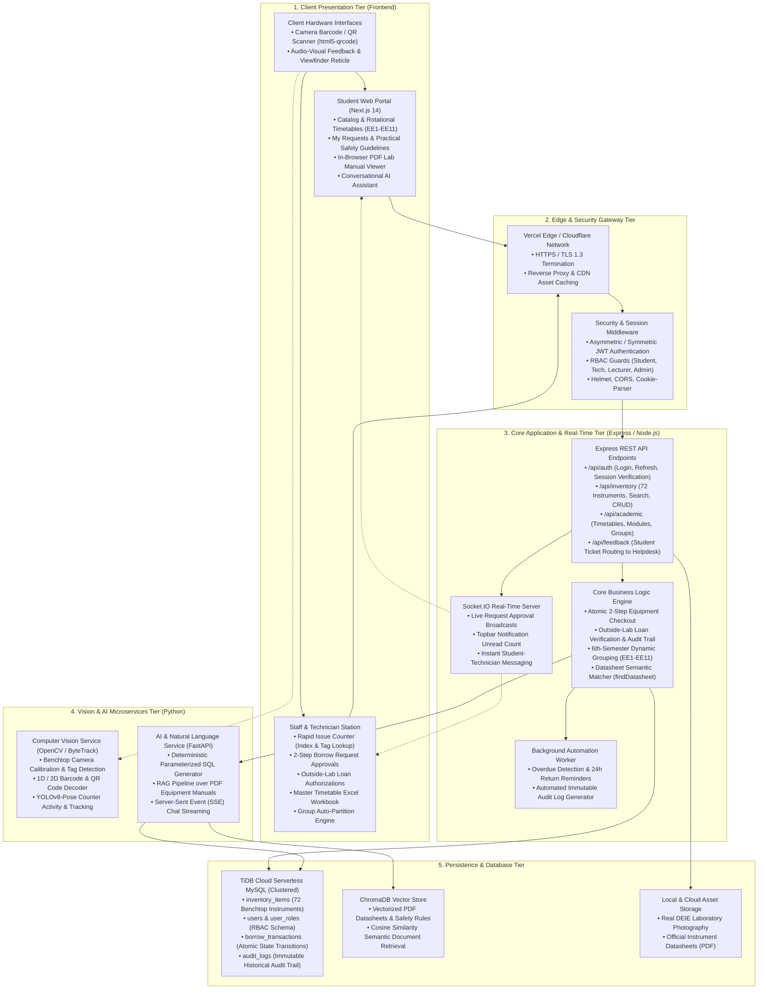

# ELABS — System Architecture & Component Design

**Project Name:** Smart Inventory Management System for DEIE Laboratories (ELABS)  
**Institution:** Department of Electrical & Information Engineering, Faculty of Engineering, University of Ruhuna  

---

## 1. High-Level Multi-Tier System Architecture Diagram

---

## 2. Architectural Design Patterns & Principles

1. **Layered Separation of Concerns (SoC):**  
   The system decouples the presentation layer (Next.js 14 App Router) from business workflows (Express API) and machine intelligence pipelines (FastAPI RAG and OpenCV).

2. **Atomic Inventory State Transitions:**  
   Equipment loan transactions use database row locks (`SELECT ... FOR UPDATE`) in MySQL/TiDB Cloud to prevent race conditions during concurrent student borrow requests.

3. **Hybrid AI & Zero-Hallucination Query Routing:**  
   The natural language assistant combines deterministic regex-parameterized SQL generators for inventory counts with ChromaDB semantic vector retrieval for equipment datasheets and safety rules.

4. **Multi-Party Event-Driven Notifications:**  
   State changes (such as a technician approving an outside-lab loan) emit WebSocket events via Socket.IO, immediately updating the student's topbar badge and active loan dashboard without full page reloads.

5. **Resilient Fail-Safe Database Adapters:**  
   Backend queries implement zero-downtime column fallbacks (`try ... catch` with `NULL as alias`), ensuring rolling schema updates and remote cloud deployments operate seamlessly without service outages.