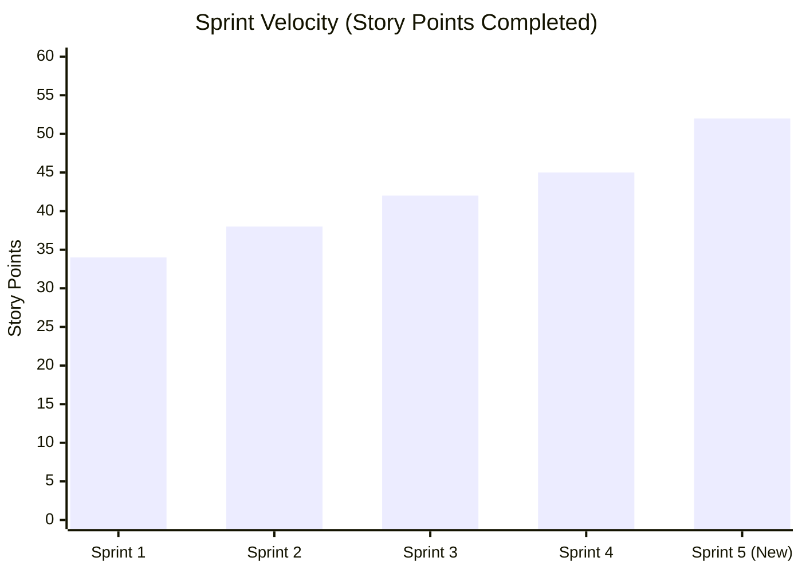

# ELABS — JIRA Agile Project Management & Sprint Tracking

**Project Name:** Smart Inventory Management System for DEIE Laboratories (ELABS)  
**Project Key:** `ELAB`  
**Board Type:** Scrum Agile Board  
**Department:** Department of Electrical & Information Engineering, Faculty of Engineering, University of Ruhuna  
**Client / Product Owner:** Ms. Sithara Madhubhashini (Technical Officer / Lab Coordinator, DEIE)  
**Scrum Master:** Weerasinghe T.H.K (`EG/2022/5401`)  
**Estimation Unit:** Story Points (Fibonacci Scale: 1, 2, 3, 5, 8, 13)  
**Total Completed Story Points:** 211 SP across Sprints 1 to 5  

---

## 1. Scrum Team Roster & JIRA User Profiles

| Member Name | Student Registration No | JIRA Username | Role | Primary Development Domain |
| :--- | :--- | :--- | :--- | :--- |
| **Weerasinghe T.H.K** | `EG/2022/5401` | `harsha.w` | Frontend Lead & Scrum Master | Next.js 14 Web App, Tailwind UI/UX, Camera Barcode Scanners, Interactive Timetables |
| **Dulanjana K.A.P** | `EG/2022/5024` | `priyan.d` | Backend Lead & Database Architect | Express TypeScript API, TiDB/MySQL Database, Atomic Transactions, Socket.IO WebSockets |
| **Dassanayake D.M.P.S.P** | `EG/2022/4983` | `pamudu.d` | Vision & Hardware Integration Lead | OpenCV Barcode/QR Pipeline, ByteTrack Tracking, YOLOv8-pose Skeleton Monitoring |
| **Adhikari A.M.I.S** | `EG/2022/4916` | `imal.a` | AI Specialist & NLP/RAG Engineer | FastAPI RAG Pipeline, ChromaDB Vector DB, Parameterized SQL Generators, Ollama/Gemini Integration |

---

## 2. JIRA Epic Hierarchy

| Epic Key | Epic Name | Summary & Scope | Epic Owner | Status |
| :--- | :--- | :--- | :--- | :--- |
| **`ELAB-EPIC-1`** | **Equipment & Inventory Lifecycle** | Item catalog, category filters, multi-item checkouts, returns, technician approvals, outside-lab loans, audit logs. | `priyan.d` | `COMPLETED` |
| **`ELAB-EPIC-2`** | **Barcode & Hardware Tracking** | Optical barcode/QR scanner (`html5-qrcode`), OpenCV tag decoding, benchtop equipment presence tracking. | `pamudu.d` | `COMPLETED` |
| **`ELAB-EPIC-3`** | **Academic Timetables & Grouping** | 6th Semester EE sub-grouping (EE1-EE11), group-isolated timetables, Excel-style spreadsheet, multi-semester switcher. | `harsha.w` | `COMPLETED` |
| **`ELAB-EPIC-4`** | **Practicals & Safety Compliance** | Practical experiment checklists, completion requirements, PDF laboratory manuals, and staff document uploads. | `harsha.w` | `COMPLETED` |
| **`ELAB-EPIC-5`** | **Real-Time Alerts & Messaging** | Multi-party instant notifications (borrow/approve/due dates), topbar notification popover, Socket.IO messaging. | `priyan.d` | `COMPLETED` |
| **`ELAB-EPIC-6`** | **Intelligent Lab Assistant (AI/RAG)** | Natural language inventory queries, zero-hallucination parameterized SQL, equipment manual semantic retrieval. | `imal.a` | `COMPLETED` |
| **`ELAB-EPIC-7`** | **Cloud DevOps & RBAC Security** | Monorepo structure, TiDB Cloud Serverless MySQL, Cloudflare Edge HTTPS deployment, Docker, JWT & RBAC. | `harsha.w` | `COMPLETED` |

---

## 3. Sprint Summary & Velocity Metrics

* **Sprint 1 (Architecture & Authentication):** 34 Story Points (100% Commitment Met)
* **Sprint 2 (Equipment Registry & Optical Baseline):** 38 Story Points (100% Commitment Met)
* **Sprint 3 (Borrow Workflows & Real-Time Messaging):** 42 Story Points (100% Commitment Met)
* **Sprint 4 (Smart Inventory Hub & Cloud Deployment):** 45 Story Points (100% Commitment Met)
* **Sprint 5 (Strict Workflow, Group Allocation & Master Timetable Hub):** 52 Story Points (100% Commitment Met)
* **Cumulative Story Points Completed:** **211 SP**

---

## 4. Sprint 5 Backlog Deep Dive (New Changes & Features)

Sprint 5 focused on implementing strict technician-supervised workflows, dynamic 6th-semester student sub-grouping, group-isolated scheduling, interactive Excel-style timetable viewing, and safety document compliance hubs.

### `ELAB-34`: Technician-Supervised 2-Step Equipment Borrowing Workflow
* **Issue Type:** Story  
* **Epic:** `ELAB-EPIC-1` (Equipment & Inventory Lifecycle)  
* **Assignee:** `priyan.d` (Backend) & `harsha.w` (Frontend)  
* **Story Points:** 5 SP  
* **Priority:** Highest  
* **Status:** `DONE`  
* **User Story:**  
  *As a laboratory student,*  
  *I want to submit an equipment borrowing request to the laboratory technician,*  
  *So that I cannot unilaterally issue equipment to myself without official staff inspection and approval.*  
* **Acceptance Criteria:**  
  - [x] Students can click "Request Borrow" on available items, selecting expected return dates and purpose.  
  - [x] Request status defaults to `PENDING_APPROVAL` and appears on the Technician/Admin Borrow Requests desk.  
  - [x] Lab Technicians can inspect student eligibility, review the request, and click "Approve & Issue" or "Reject".  
  - [x] Equipment state transitions atomically from `AVAILABLE` to `BORROWED` only upon technician authorization.

---

### `ELAB-35`: Outside-Lab Equipment Loan Request & Authorization Workflow
* **Issue Type:** Story  
* **Epic:** `ELAB-EPIC-1` (Equipment & Inventory Lifecycle)  
* **Assignee:** `priyan.d` (Backend) & `harsha.w` (Frontend)  
* **Story Points:** 5 SP  
* **Priority:** High  
* **Status:** `DONE`  
* **User Story:**  
  *As a student working on an external engineering project,*  
  *I want to request permission to take laboratory instruments outside the designated lab room,*  
  *So that technicians can review my destination lab, project purpose, and return deadline before granting custody.*  
* **Acceptance Criteria:**  
  - [x] Borrow request modal includes a mandatory toggle: "Take Outside the Lab?".  
  - [x] When enabled, user must specify the destination lab/location (e.g. Project Development Lab) and faculty project purpose.  
  - [x] The loan request requires explicit technician verification before equipment can physically leave the laboratory.  
  - [x] System logs destination location and loan terms into `borrow_transactions` and `audit_logs`.

---

### `ELAB-36`: Role-Based Tab & Action Isolation (Hide "My Borrows" from Staff)
* **Issue Type:** Story  
* **Epic:** `ELAB-EPIC-1` (Equipment & Inventory Lifecycle)  
* **Assignee:** `harsha.w` (Frontend)  
* **Story Points:** 2 SP  
* **Priority:** Medium  
* **Status:** `DONE`  
* **User Story:**  
  *As a System Administrator or Lab Technician,*  
  *I want the "My Borrows" tab hidden from my inventory navigation,*  
  *So that my dashboard is focused on managing student check-outs and department assets rather than irrelevant personal loans.*  
* **Acceptance Criteria:**  
  - [x] Navigation tabs conditionally render based on authenticated user role (`STUDENT` vs `TECHNICIAN`/`ADMIN`).  
  - [x] Technicians and Admins see "Active Loans (All Students)", "Pending Requests", and "Inventory Registry".  
  - [x] Students see "Equipment Catalog", "My Requests", and "My Borrows".

---

### `ELAB-37`: High-Precision In-Browser Barcode & QR Camera Scanner with Viewfinder UX
* **Issue Type:** Story  
* **Epic:** `ELAB-EPIC-2` (Barcode & Hardware Tracking)  
* **Assignee:** `harsha.w` (Frontend) & `pamudu.d` (Vision)  
* **Story Points:** 5 SP  
* **Priority:** High  
* **Status:** `DONE`  
* **User Story:**  
  *As a lab technician at the issue counter,*  
  *I want an intuitive, accurate webcam barcode scanner with a visual targeting box and audio-visual feedback,*  
  *So that I can scan equipment tags (`ELABS-PS-0001`) in under 500ms without manual typing errors.*  
* **Acceptance Criteria:**  
  - [x] Modern camera modal with targeting reticle/viewfinder and animated scanning line.  
  - [x] High-accuracy detection powered by `html5-qrcode` supporting Code-128, Code-39, EAN-13, and QR tags.  
  - [x] Auto-fills equipment details instantly upon successful read and plays visual confirmation badge.  
  - [x] Fallback to manual entry with live index search (`EG/2022/xxxx`) and equipment tag auto-complete.

---

### `ELAB-38`: Real-Time Multi-Party Notification Matrix & Topbar Dropdown
* **Issue Type:** Story  
* **Epic:** `ELAB-EPIC-5` (Real-Time Alerts & Messaging)  
* **Assignee:** `priyan.d` (Backend) & `harsha.w` (Frontend)  
* **Story Points:** 5 SP  
* **Priority:** Highest  
* **Status:** `DONE`  
* **User Story:**  
  *As a laboratory user (student or staff),*  
  *I want instant notifications whenever requests are submitted, approved, rejected, or approaching their due dates,*  
  *So that all stakeholders stay synchronized without manually checking request tables.*  
* **Acceptance Criteria:**  
  - [x] Admin/Technician receive instant notifications when any student submits a borrowing or outside-loan request.  
  - [x] Student receives instant notification when a technician approves, rejects, or issues their requested items.  
  - [x] Automated system notifications generated 24 hours before due date and immediately when overdue.  
  - [x] Interactive topbar notification bell popover displaying unread count badge, mark-as-read, and navigation links.

---

### `ELAB-39`: 6th Semester EE Student Group Allocation Engine (EE1 - EE11)
* **Issue Type:** Story  
* **Epic:** `ELAB-EPIC-3` (Academic Timetables & Grouping)  
* **Assignee:** `priyan.d` (Backend) & `harsha.w` (Frontend)  
* **Story Points:** 5 SP  
* **Priority:** Highest  
* **Status:** `DONE`  
* **User Story:**  
  *As a System Administrator or Lab Coordinator,*  
  *I want 6th-semester Electrical & Information Engineering students automatically partitioned into balanced groups of 7,*  
  *So that high-density lab sessions operate safely within bench capacity constraints.*  
* **Acceptance Criteria:**  
  - [x] 75 registered 6th Semester EE students partitioned into 11 sub-groups (`EE1` through `EE11`, 7 per group; `EE11` with 8).  
  - [x] Admin console (`/admin/semester-groups`) displaying live rosters per group with student names and registration numbers.  
  - [x] 1-Click "Auto-Partition Students" button distributing unassigned students evenly.  
  - [x] Interactive student reassignment dropdown allowing technicians to transfer students between groups dynamically.

---

### `ELAB-40`: Strict Group-Isolated Academic Timetables & Notifications
* **Issue Type:** Story  
* **Epic:** `ELAB-EPIC-3` (Academic Timetables & Grouping)  
* **Assignee:** `harsha.w` (Frontend) & `priyan.d` (Backend)  
* **Story Points:** 5 SP  
* **Priority:** Highest  
* **Status:** `DONE`  
* **User Story:**  
  *As an EE3 student,*  
  *I want to see timetable slots and receive laboratory notifications ONLY for my assigned group (`EE3`),*  
  *So that I am not confused by rotational lab dates intended for groups EE1, EE2, or EE4.*  
* **Acceptance Criteria:**  
  - [x] API queries (`/academic/timetable/my-group`) resolve the authenticated student's group code (`EE3`).  
  - [x] Student dashboard calendar and timetable displays only the rotational practicals assigned to their specific sub-group.  
  - [x] Notification scheduler sends upcoming lab reminders only to students enrolled in that specific practical's group session.

---

### `ELAB-41`: Interactive Master Timetable Excel-Style Workbook
* **Issue Type:** Story  
* **Epic:** `ELAB-EPIC-3` (Academic Timetables & Grouping)  
* **Assignee:** `harsha.w` (Frontend)  
* **Story Points:** 5 SP  
* **Priority:** High  
* **Status:** `DONE`  
* **User Story:**  
  *As a student or staff member,*  
  *I want an Excel-like interactive spreadsheet view of the master laboratory schedule with cell coordinates and formula bar,*  
  *So that I can inspect the entire semester's multi-module lab distribution at a glance and export it to CSV.*  
* **Acceptance Criteria:**  
  - [x] High-density grid with spreadsheet column headers (`A`, `B`, `C`, `D`, `E`, `F`) and numbered rows (`1`, `2`, `3`, ...).  
  - [x] Interactive formula bar (`fx`) displaying selected cell coordinates (e.g. `B4`) and cell content dynamically.  
  - [x] Multi-criteria filters by Module (EE5206, EE5207, EE5208, EE5209) and Group (`EE1` - `EE11`).  
  - [x] Instant search bar filtering practical titles, dates, and laboratory venues in real-time.  
  - [x] "Export CSV" button generating standardized `.csv` files for offline spreadsheet analysis.

---

### `ELAB-42`: Multi-Semester Selector & Faculty-Wide All-Semesters Master Schedule
* **Issue Type:** Story  
* **Epic:** `ELAB-EPIC-3` (Academic Timetables & Grouping)  
* **Assignee:** `harsha.w` (Frontend) & `priyan.d` (Backend)  
* **Story Points:** 5 SP  
* **Priority:** High  
* **Status:** `DONE`  
* **User Story:**  
  *As a System Administrator,*  
  *I want a semester dropdown selector and an "All Semesters" faculty master view,*  
  *So that I can oversee laboratory utilization across Semesters 1 through 8 and R&D projects rather than being locked to one semester.*  
* **Acceptance Criteria:**  
  - [x] Dynamic semester selector in top header supporting Semesters 1, 2, 3, 4, 5, 6, 7, 8, and R&D / Final Year Projects.  
  - [x] System Administrator can choose "All Semesters" to view a consolidated cross-faculty timetable matrix.  
  - [x] Students default automatically to their active enrolled semester (Semester 6) with read-only access.

---

### `ELAB-43`: Module Practicals Catalog & Laboratory Safety Compliance Hub
* **Issue Type:** Story  
* **Epic:** `ELAB-EPIC-4` (Practicals & Safety Compliance)  
* **Assignee:** `harsha.w` (Frontend) & `priyan.d` (Backend)  
* **Story Points:** 5 SP  
* **Priority:** High  
* **Status:** `DONE`  
* **User Story:**  
  *As an undergraduate engineering student,*  
  *I want to view a comprehensive list of all required practicals for my semester with safety guidelines and completion criteria,*  
  *So that I arrive prepared with prerequisite knowledge and compliant laboratory safety gear.*  
* **Acceptance Criteria:**  
  - [x] Practicals catalog listing all experiments across 6th Semester modules with duration, venue, and completion status.  
  - [x] Clicking any practical opens `PracticalDetailsModal` showing:  
    - Objectives & Equipment Required  
    - Mandatory Safety Regulations (PPE, high-voltage precautions, grounding rules)  
    - Prerequisite reading and completion criteria (logbook sign-off, viva, simulation check)

---

### `ELAB-44`: Practical Lab Manual PDF Preview & Staff Document Upload Capability
* **Issue Type:** Story  
* **Epic:** `ELAB-EPIC-4` (Practicals & Safety Compliance)  
* **Assignee:** `harsha.w` (Frontend) & `priyan.d` (Backend)  
* **Story Points:** 3 SP  
* **Priority:** Medium  
* **Status:** `DONE`  
* **User Story:**  
  *As an academic staff member or lab technician,*  
  *I want to upload lab manuals, safety guidelines, and instruction sheets directly to any practical,*  
  *So that students can preview and download the official PDFs before entering the laboratory.*  
* **Acceptance Criteria:**  
  - [x] Document upload zone in practical details modal supporting PDF and DOCX formats up to 25MB.  
  - [x] In-browser PDF preview iframe allowing students to read experiment procedures directly without external software.  
  - [x] Upload authorization restricted to `ADMIN` and `TECHNICIAN` roles via JWT verification.

---

### `ELAB-45`: Authentic Department Laboratory Photography & UI Polish
* **Issue Type:** Story  
* **Epic:** `ELAB-EPIC-7` (DevOps & UI Architecture)  
* **Assignee:** `harsha.w` (Frontend)  
* **Story Points:** 2 SP  
* **Priority:** Medium  
* **Status:** `DONE`  
* **User Story:**  
  *As a department stakeholder,*  
  *I want real, high-resolution photography of our DEIE laboratory facilities displayed across the portal,*  
  *So that the application reflects our authentic physical engineering benches rather than generic stock imagery.*  
* **Acceptance Criteria:**  
  - [x] Real photographic assets integrated for all 6 official DEIE laboratories:  
    1. Power Systems & High Voltage Laboratory  
    2. Electronics & Circuits Laboratory  
    3. Telecommunications & RF Laboratory  
    4. Networking & Systems Laboratory  
    5. Electric Machines & Drives Laboratory  
    6. Project Development & Innovation Laboratory  
  - [x] Fixed messaging system (`/messages`) re-render cycle, recipient name resolution, and clean enterprise styling.

---

## 5. Complete Sprints 1 to 4 Backlog Reference

### Sprint 1: Architecture, Normalized Schema & Authentication (34 SP)
* `ELAB-1` (8 SP): Monorepo Architecture Setup (Next.js, Express, FastAPI, Shared Packages) — `harsha.w`
* `ELAB-2` (8 SP): MySQL Database Schema Design (`inventory_items`, `users`, `borrow_transactions`, `labs`) — `priyan.d`
* `ELAB-3` (5 SP): JWT Authentication & RBAC Permission Guards — `priyan.d`
* `ELAB-4` (5 SP): OpenCV Benchtop Optical Frame Pipeline & Camera Calibration — `pamudu.d`
* `ELAB-5` (5 SP): FastAPI Microservice Setup & SQLAlchemy Connection Pooling — `imal.a`
* `ELAB-6` (3 SP): Tailwind CSS Theme & Department Brand Design System — `harsha.w`

### Sprint 2: Core Equipment Registry & LMS Academic Integration (38 SP)
* `ELAB-7` (8 SP): Equipment Registry & Category Filtering UI (Measurement, Power Supplies, Oscilloscopes) — `harsha.w`
* `ELAB-8` (8 SP): RESTful Equipment CRUD Endpoints & Laboratory Location Routing — `priyan.d`
* `ELAB-9` (8 SP): Optical Barcode & QR Code Reader Engine (`elabs_tag`) — `pamudu.d`
* `ELAB-10` (8 SP): Deterministic Parameterized SQL Intent Classifier for Inventory Queries — `imal.a`
* `ELAB-11` (3 SP): LMS Course Practical Module Registration Architecture — `harsha.w`
* `ELAB-12` (3 SP): Barcode Tag Query Endpoint (`/items/barcode/:tag`) — `priyan.d`

### Sprint 3: Borrow Workflows, Real-Time Messaging & Assessment Engine (42 SP)
* `ELAB-13` (8 SP): Interactive Check-out Modal & Student Practical Equipment Checklists — `harsha.w`
* `ELAB-14` (8 SP): Transactional Borrow & Return Backend Processing Pipeline — `priyan.d`
* `ELAB-15` (8 SP): Socket.IO Real-Time Chat & Status Broadcaster (`/messages`) — `priyan.d` & `harsha.w`
* `ELAB-16` (8 SP): ByteTrack Entry/Exit Monitoring & YOLOv8-pose Skeleton Estimation — `pamudu.d`
* `ELAB-17` (8 SP): RAG Vector Indexing Pipeline for PDF Manuals & Experiment Procedures — `imal.a`
* `ELAB-18` (2 SP): Lab Report Upload & Assessment Grading Interface — `harsha.w`

### Sprint 4: Smart Inventory Hub, Barcode Automation & Cloud Deployment (45 SP)
* `ELAB-19` (8 SP): Smart Inventory Hub UI (`/inventory`) with Live Status Pills & Filters — `harsha.w`
* `ELAB-20` (8 SP): Rapid Issue Station with Instant Student Index Verification (`EG/2022/xxxx`) — `harsha.w`
* `ELAB-21` (5 SP): In-Browser Camera Barcode/QR Scanner Integration (`html5-qrcode`) — `harsha.w`
* `ELAB-22` (8 SP): Atomic Inventory Transactions with TiDB Cloud Serverless MySQL & SSL — `priyan.d`
* `ELAB-23` (5 SP): Automated Overdue Tracking Engine with Immutable `audit_logs` — `priyan.d`
* `ELAB-24` (5 SP): Optical Return Verification Station & Physical Asset Tracking — `pamudu.d`
* `ELAB-25` (6 SP): Natural Language AI Assistant with Student Context & SSE Streaming — `imal.a`

---

## 6. JIRA CSV Export / Import Specification

A ready-to-import CSV file has been generated at [`docs/jira_backlog_export.csv`](file:///c:/software%20project/docs/jira_backlog_export.csv).

### Column Structure:
1. `Issue Type` (Epic, Story, Task)
2. `Issue key` (`ELAB-xx`)
3. `Summary`
4. `Description`
5. `Assignee` (`harsha.w`, `priyan.d`, `pamudu.d`, `imal.a`)
6. `Reporter` (`harsha.w`)
7. `Priority` (Highest, High, Medium, Low)
8. `Story Points` (1 to 13)
9. `Epic Link` (`ELAB-EPIC-1` to `ELAB-EPIC-7`)
10. `Sprint` (Sprint 1, Sprint 2, Sprint 3, Sprint 4, Sprint 5)
11. `Status` (`DONE`)
12. `Resolution` (`Done`)

---

## 7. How to Import into JIRA Software

1. Log into your Atlassian JIRA account (e.g. `https://your-org.atlassian.net`).
2. Navigate to **Jira Settings** > **System** > **External System Import**.
3. Select **CSV** import option.
4. Upload [`docs/jira_backlog_export.csv`](file:///c:/software%20project/docs/jira_backlog_export.csv).
5. Map fields directly:
   - `Issue key` -> `Issue Key`
   - `Issue Type` -> `Issue Type`
   - `Summary` -> `Summary`
   - `Description` -> `Description`
   - `Story Points` -> `Story Points`
   - `Epic Link` -> `Epic Link`
   - `Sprint` -> `Sprint`
   - `Status` -> `Status`
6. Click **Begin Import**. All 5 Sprints, 7 Epics, and 45 User Stories will be populated on your Scrum Board with completed velocity metrics.
